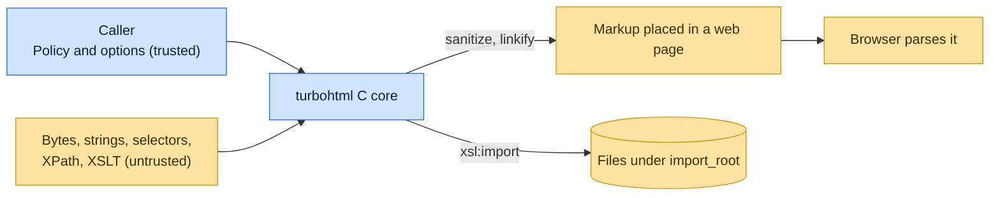

# Threat model

This model says what turbohtml trusts, where untrusted input enters, and which guarantees hold at each boundary, so a
report can be classified as a vulnerability or a bug. [SECURITY.md](SECURITY.md) covers reporting; if the two disagree,
SECURITY.md wins and we fix this file.

## How turbohtml works

A C extension (`turbohtml._html`) does the tokenizing, WHATWG tree building, querying (CSS selectors, XPath, XSLT),
serializing, minifying and sanitizing; the Python package is a thin typed facade. Bytes pass through encoding sniffing
and the legacy decoders first. `turbohtml.clean.sanitize` and `linkify` produce markup meant to be placed in a web page,
and the `migration.bleach` and `migration.markupsafe` shims route to them. turbohtml makes no network requests.

## Compared with similar tools

We drew the boundary where comparable projects in other ecosystems draw theirs. The shared rule, stated by the
[Node.js threat model](https://github.com/nodejs/node/blob/main/SECURITY.md#the-nodejs-threat-model), is that a report
which first needs a trusted element compromised is out of scope; the first triage question, as
[DOMPurify](https://github.com/cure53/DOMPurify/blob/main/SECURITY.md#what-we-consider-a-vulnerability) puts it, is what
the attacker controls.

| Project                                                          | Language     | Where it draws the line                                                                                                                                                              |
| ---------------------------------------------------------------- | ------------ | ------------------------------------------------------------------------------------------------------------------------------------------------------------------------------------ |
| [DOMPurify](https://github.com/cure53/DOMPurify/security/policy) | JavaScript   | A default-configuration bypass from input alone is a vulnerability; one that needs the application to allow a dangerous construct is a hardening bug. turbohtml uses the same split. |
| [jsoup](https://github.com/jhy/jsoup/security/policy)            | Java         | A report must name a guarantee jsoup itself violates; risks from a custom `Safelist` are the caller's.                                                                               |
| [lxml](https://github.com/lxml/lxml/security/policy)             | Python and C | C-backed parser on untrusted input; private reports and a 90-day window.                                                                                                             |
| [parse5](https://github.com/inikulin/parse5/security/policy)     | JavaScript   | WHATWG parser; supports only the current release.                                                                                                                                    |

## Trusted

An attacker who controls any of these already has what turbohtml could give them:

- The caller, its sanitizer `Policy`, hooks and options.
- The `import_root` directory and the files a caller asks it to read.
- The Python interpreter, the C runtime and the free-threaded build's thread safety for objects the caller shares
  between threads.

## Untrusted inputs

| Input                         | Comes from                                | What turbohtml guarantees                                                                    |
| ----------------------------- | ----------------------------------------- | -------------------------------------------------------------------------------------------- |
| Bytes and strings to parse    | Any document or fragment                  | Parsed without memory-safety faults; malformed input yields a tree or a catchable exception. |
| Markup to sanitize or linkify | Any user-generated content                | Under the default `Policy()`, output does not run script when a browser parses it.           |
| CSS selectors, XPath, XSLT    | Query text the caller may take from users | Evaluated without memory-safety faults; `xsl:import` stays within `import_root`.             |
| Encoding declarations         | BOM, `<meta charset>`, prescan            | Decoded through the WHATWG encoding tables only.                                             |

## Threats and controls

| STRIDE                 | Threat                                                                       | Control                                                                                          |
| ---------------------- | ---------------------------------------------------------------------------- | ------------------------------------------------------------------------------------------------ |
| Tampering              | Serialized output reparses into a different, executable tree (mutation XSS). | Sanitizer wrong-output oracles compare output against independent parses by html5lib and parse5. |
| Information disclosure | An out-of-bounds read leaks process memory into returned output.             | ASan and UBSan fuzzing of parse, serialize, sanitize, URL and IDNA targets.                      |
| Denial of service      | A short input causes super-linear time or expansion blowup.                  | Fuzzing with an operation limit; reported as a vulnerability when the input is small.            |
| Elevation of privilege | Memory corruption in the C extension gives code execution.                   | Fuzzing, sanitizer builds and a test for every fixed crasher in `tests/fuzz_regressions/`.       |

## Release chain

Releases run on the shared [tox-dev/github-workflows](https://github.com/tox-dev/github-workflows) pipeline. A release
App, not a person, pushes the release commit and tag; the build installs its tools hash-checked from `pylock.toml` with
a seven-day upload cooldown; PyPI receives the files through
[trusted publishing](https://docs.pypi.org/trusted-publishers/) with attestations, and the GitHub Release is immutable.
Every workflow pins third-party actions to a commit SHA.

Some `_c/data/` tables are generated from upstream sources (the IANA TLD list, the Public Suffix List, the UTS #46
tables). Each generator pins the upstream version or commit and the SHA-256 of the exact bytes, and aborts when a
download does not match, so a poisoned source cannot land silently.

## Vulnerability or bug

| Report                                                                      | Verdict             | Why                                            |
| --------------------------------------------------------------------------- | ------------------- | ---------------------------------------------- |
| `sanitize()` with the default policy keeps `<svg><a href="javascript:...">` | Vulnerability       | Default-configuration bypass from input alone. |
| A policy allowing `onerror` keeps `onerror`                                 | Not a vulnerability | The caller allowed the dangerous attribute.    |
| `parse()` segfaults on a 200-byte input                                     | Vulnerability       | Memory-safety fault on untrusted input.        |
| `parse()` raises `ValueError` on bad input                                  | Bug                 | Catchable exception, no corruption.            |
| `<table>` nesting differs from browsers but stays inert                     | Bug                 | Divergence without security impact.            |

## Accepted risks

- Free-threaded data races on objects the caller shares across threads are the caller's to synchronize.
- Very large inputs can take proportionally long; only blowup from small inputs is a vulnerability.

## Keeping this current

Revisit this model when turbohtml gains a new input source, network access, a new way to run code, or a new place it
writes to, and whenever an advisory is published.
